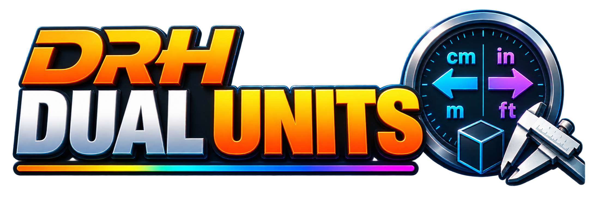
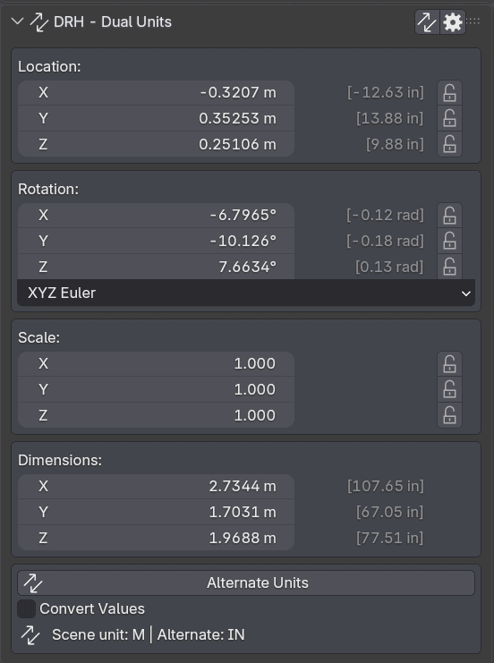

# DRH - Dual Units & Measurements

**The brief says six feet. Your scene says meters. Look at both without opening a calculator.**

  

  

## The wall

Imperial plans, metric scenes, a supplier who quotes in inches, and a 3D print sliced in millimeters. Blender shows you one unit system at a time, so every dimension check becomes a conversion in your head, and the errors show up after the print.

Dual Units puts a second unit system under the one you're already reading. Same panel you know from Transform, with an extra column.

## What's in it

- Familiar N panel layout: Location, Rotation, Scale, and Dimensions with scene units and your alternate unit shown side by side. No manual conversion.
- Alternate units for length from meters down to millimeters and up to kilometers, plus inches, feet, yards, and miles.
- Alternate rotation units for the cases where degrees aren't what the drawing uses.
- Precision control from 0 to 6 decimals, so a milled part and a wall don't get the same rounding.
- Optional split-unit formatting for the unit families that support it, which is how plans usually get written.
- Scene unit presets for metric, imperial, product, architecture, site, carpentry, and 3D printing workflows.

Version 1.1.0 extended the preset set and the alternating rotation support, and tightened the precision and split-unit handling.

## Who it's for

Furniture and product modelers working from imperial specs. Architectural visualizers pulling metric drawings into feet. Anyone printing a Blender model where 0.4 mm decides whether the part fits.

## Get it

Free on BlendKit, Blender 4.2 or newer, Windows, macOS, or Linux.

Changelog: [CHANGELOG.md](CHANGELOG.md) · Bugs and requests: [open an issue](https://github.com/pacosalasv/DRH_Dual_Units-Support/issues)

  

